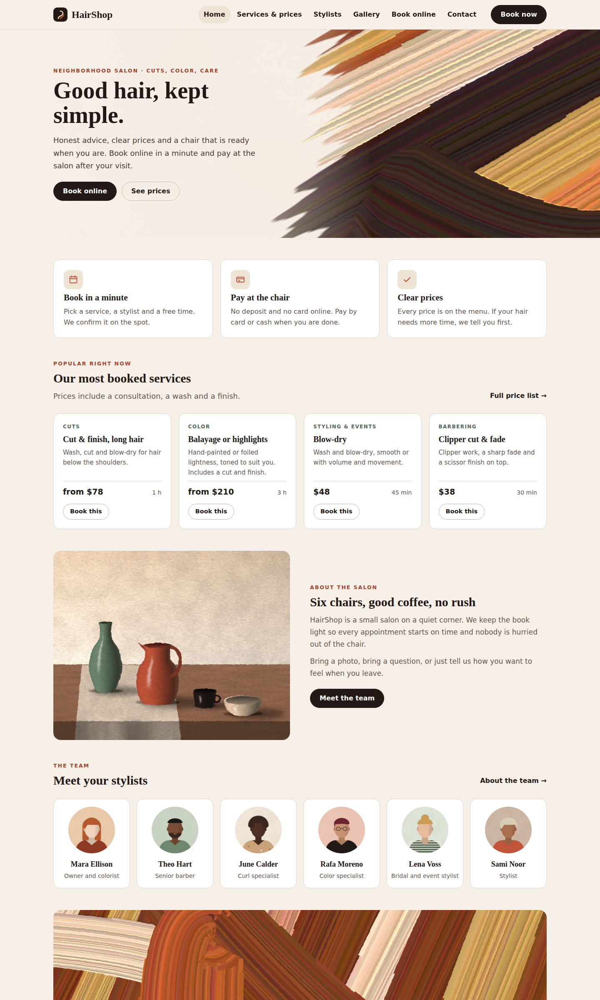
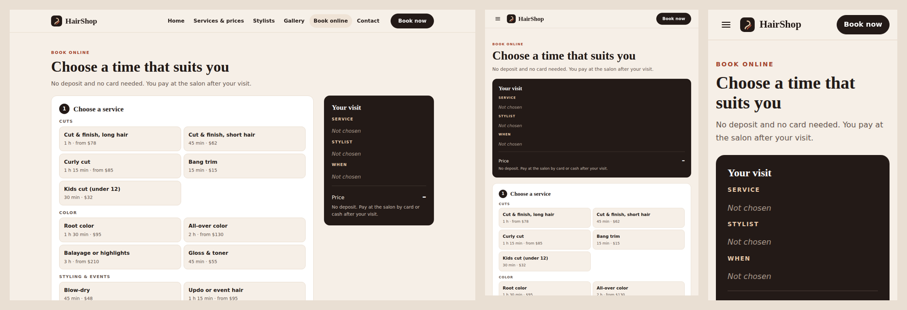

# HairShop — SkyNet Hair Salon Template

A responsive hair salon website template for **ASP.NET Core (.NET 10)**, built on the **SkyNet Framework**.

[](https://dotnet.microsoft.com/)
[](https://www.nuget.org/packages/TheSkyLite.SkyNet)



> **Sample content.** HairShop and its stylists, services, prices, address and artwork are placeholders. Replace them in the staff area (Settings, Services, Stylists, Pages, Media library) or in `data/site.json`. Every form already saves for real: bookings go to `data/bookings.json`, guests to `data/guests.json` and contact messages to `data/messages.json`.

## Features

- **21 pages.**
  - 6 public: Home, Services & prices, Stylists, Gallery, Book online, Contact.
  - 15 staff: Sign in, Today, Bookings, Checkout, Guests, Tips report, Services, Stylists, Pages, Media library, Messages, Settings, Users and rights, Activity log, My account.
- **Responsive.** Desktop, tablet and phone layouts.
- **Online booking.** The guest chooses a service, a stylist (or Any stylist), a day and a free time.
  - The server works out the free times from the salon's opening hours, each stylist's weekly hours, breaks and days off, the service length, a clean-up buffer and every live booking.
  - When the guest presses Book, the server checks everything again under a lock. A time someone else just took, a time outside working hours, and a stylist who does not offer the service are all refused.
  - There is no deposit and no online payment.
- **Guests register.**
  - Each guest is one record, matched by phone or email. A record is created on the first booking or by staff.
  - Each record holds notes, totals spent and tips, upcoming and past visits, and a button that starts a booking for that guest.
  - Bookings, check-in and checkout all link to the guest record.
- **Visit flow.** Every visit goes booked → arrived (check-in) → done → paid. No-show and cancelled visits keep their reason, and staff with the right can restore a visit while its time is still free.
- **Bookings screen.**
  - Day view with one column per stylist, shaded off-hours, and click-to-book on an empty spot.
  - List view with date range, status and search.
  - Staff bookings go through the same clash and working-hours checks as online ones.
- **Checkout.**
  - The service total comes from the price list. Staff can add extra services. A "from" price service can be set higher at checkout.
  - Optional discount.
  - Tip buttons for 15, 18 and 20% (changeable in Settings), worked out on the service total before the discount, or a custom tip.
  - Paid by card or cash, with a printable receipt. Reopening a paid visit needs its own right and is logged.
- **Tips by stylist.** Per-stylist report for any date range: card and cash tips, totals and average tip %, with a CSV download.
- **Owner-editable website.**
  - A block-based Pages editor with versions and Restore.
  - A Media library with photo and MP4 upload, checked by file content. "Show in gallery" and a group drive the Gallery page.
  - A Messages inbox for the contact form.
- **Staff rights.**
  - View, Edit and an Extra right per area.
  - "Own records only" for stylists, so they see only their bookings, guests, checkout and tips.
  - Every refused request and every change is logged.
- **No front-end build.** Plain HTML, CSS and vanilla JavaScript.
- **Artwork.** 23 original images and a short video, all painted in code.



## Getting started

Requirements: .NET 10 SDK.

    cd HairShop
    dotnet run

The SkyNet package (`TheSkyLite.SkyNet`) restores from NuGet. The app opens on **Home** at http://localhost:5214. The staff area is at **/AdminLogin**.

## Permissions

| Area | Rights | Extra right |
|---|---|---|
| Bookings | View, Edit | Cancel and no-show |
| Checkout | View, Edit | Reopen a paid visit |
| Guests | View, Edit | Delete a guest (only one with no visits) |
| Tips report | View | |
| Services | View, Edit | |
| Stylists | View, Edit | Working hours and days off |
| Pages | View, Edit | |
| Media library | View, Edit | Delete files |
| Messages | View, Edit | Delete messages |
| Activity log | View | |
| Settings, Users and rights | managers only | |

Link a user to a stylist and tick **Own records only**. That user then sees only that stylist's bookings, checkout, guests and tips.

## Run mode

`appConfig/application.cfg` has `app.app.runmode`:

- **0 Demo** (as shipped): the staff sign-in is filled in (`demo` / `demo1234`), and any user name and password signs in as a demo manager with every right.
- **1 Production:** staff sign in with their own accounts. Set this before you go live. Switching to 1 ends every demo session.

## First sign-in (Production)

1. Run the site on your computer and open **/AdminLogin**. The page shows the first user name (`admin`) and a password made just for this site. It is shown only on the computer the site runs on, and it is also in `appConfig/initial-admin.txt`.
2. Sign in and choose your own password. The box and the file disappear.
3. Open **Users and rights** and add an account for each person. Each new user gets a temporary password and chooses their own on first sign-in.

Forgot the first password before using it? Delete `appConfig/initial-admin.txt` and open the sign-in page again. Locked out of every manager account? Remove the managers from `data/staff.json` and open the sign-in page.

## Deploying

1. Publish with the `web.config` from the project (IIS) and use HTTPS. Give the application pool Modify on:
   - `data/`
   - `temp/`
   - `appConfig/`
   - `images/uploads/` (create it first)
2. If nobody has signed in yet, read the first password from `appConfig/initial-admin.txt` on the server.
3. Check in a browser that `/data/staff.json` and `/appConfig/initial-admin.txt` answer 404.

> **Redeploying:** publishing copies `data/` over the live files, which hold your bookings, guests and payments. Download the live `data/` folder first, or leave it out of the publish.

Personal data kept: name, phone, email, visit history and payments, plus staff notes about hair. The note fields say not to record health details.

## Project structure

    appConfig/application.cfg   settings, run mode, placeholder secrets
    codes/                      one class per page (21) + Core/ (Store, Access, Auth, Local, Ui, Diary, Media, Blocks) + Models/
    htmls/ scripts/ styles/     page markup, JavaScript and CSS
    data/site.json              salon details, hours, services, stylists, page blocks
    images/                     hero, stylists/, gallery/, salon/, video/ (uploads go to images/uploads/)

`codes/Core/Diary.cs` holds the booking rules: free slots, clash and working-hours checks, guest matching and the checkout totals. Both the public Book page and the staff screens use it.

### One page = four files, one name

| File | Holds |
|---|---|
| `codes/[Page].cs` | the page class and its server methods |
| `htmls/[Page].html` | markup with `{plhd_*}` placeholders |
| `scripts/[Page].js` | one IIFE namespace, `[Page]Js` |
| `styles/[Page].css` | styles, every class prefixed (`bk-`, `bo-`, `co-` …) |

## SkyNet in action

```js
call('Plan', [{ key: 'svc', vlu: st.svc }, { key: 'sty', vlu: st.sty }, { key: 'day', vlu: st.day }, { key: 'at', vlu: st.at }]);
```

```csharp
public async Task<ApiResponse> Plan()
{
    SalonService? svc = Svc(site, GetDataValue("svc"));
    ...
    response.SetElementContents("bk-days", DaysHtml(site, bookings, svc, sty, day));
    response.SetElementContents("bk-times", TimesHtml(site, bookings, svc, sty, day, at));
    return response;
}
```

| Page | Request | Response |
|---|---|---|
| Book | `Plan` | stylists, day strip with free counts, free times, summary |
| Book | `Reserve` | field errors, or the confirmation with a reference (HS-XXXXX) |
| AdminBookings | `Act` | new status on the card, refreshed day view and menu badges |
| AdminCheckout | `Sum` / `Pay` | live totals with tip amounts / the receipt |
| AdminTips | `Report` / `Csv` | per-stylist table / a CSV download |

## Customize it

- **Salon name, contact details, hours, booking rules, tip buttons:** Settings in the staff area.
- **Services, prices, stylists, hours, days off:** Services and Stylists in the staff area.
- **Page text and pictures:** Pages and the Media library.
- **Colors and fonts:**
  - The CSS variables at the top of each `styles/*.css` (ink `#231A17`, oat `#F6EFE7`, terracotta `#C2553A`, sage `#6F876F`, sand `#E8C9A9`).
  - Fonts are Fraunces and Inter, with system fallbacks.

## License

- **This template:** choose your own license before you publish it.
- **SkyNet Framework** (`TheSkyLite.SkyNet` NuGet package): proprietary, free to use for eligible users including commercial use; see the license included in the package.
